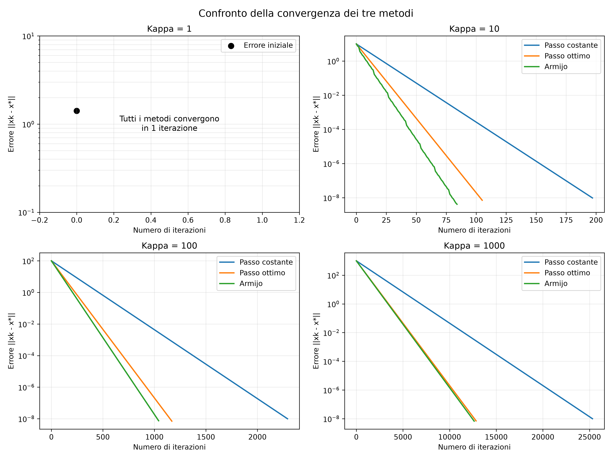
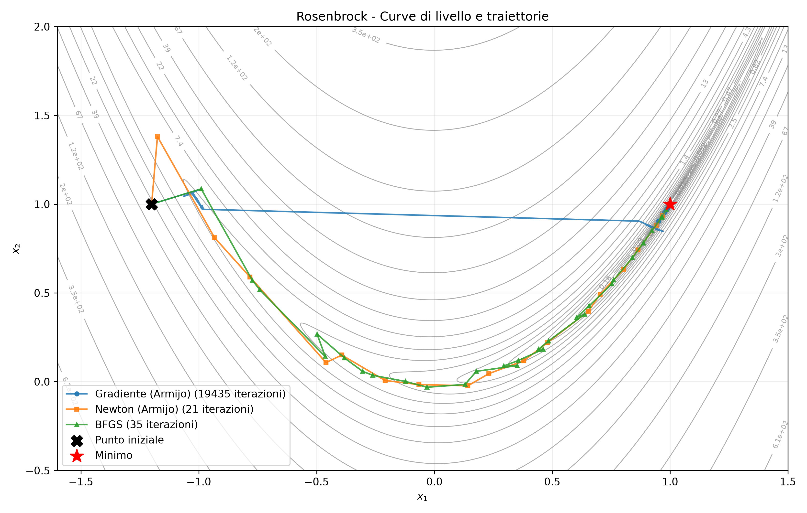
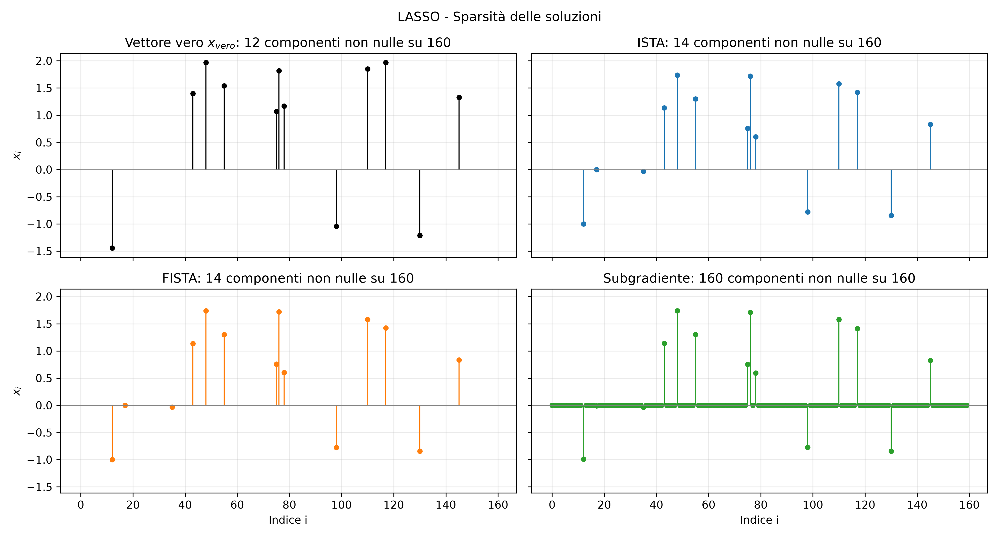

# Project 1 — Numerical Optimization Methods

## Overview

This project studies the behavior and convergence of several **unconstrained and proximal optimization algorithms**. The implementations are tested on quadratic objectives, the Rosenbrock function, a sparse LASSO problem, and regularized logistic regression.

## Exercises

| Part | Problem | Main activities |
| --- | --- | --- |
| **1** — `parte1.py` | Convex quadratic minimization | Gradient descent with different step-size rules; influence of matrix conditioning; comparison between theoretical and experimental convergence |
| **2** — `parte2.py` | Rosenbrock function | Comparison of gradient descent, damped Newton with Armijo line search, and quasi-Newton BFGS; analysis of trajectories and computational effort |
| **3** — `parte3.py` | LASSO / sparse recovery | L1 regularization, soft-thresholding and comparison of subgradient, ISTA and FISTA methods; analysis of convergence and sparsity |
| **4** — `parte4.py` | L2-regularized logistic regression | Comparison of first-order, second-order and proximal algorithms; convergence analysis, evaluation counts and execution times |

Shared implementations of the optimization methods are located in [`metodi.py`](metodi.py).

## Project files

- `metodi.py`: reusable implementations of Armijo line search, gradient descent, Newton, BFGS, soft-thresholding, ISTA, FISTA and the subgradient method.
- `parte1.py`–`parte4.py`: the four numerical experiments.
- `grafici/`: generated convergence plots, trajectories and sparsity visualizations.
- `risultati_pt4.csv`: summary table produced by the regularized logistic regression experiment.

## Requirements

- Python 3
- NumPy
- Matplotlib
- SciPy *(optional, used only for a BFGS cross-check in Part 4)*

Install the main dependencies with:

```bash
pip install numpy matplotlib
```

## How to run

From the `Project 1` directory, execute:

```bash
python parte1.py
python parte2.py
python parte3.py
python parte4.py
```

Run the scripts from this directory because the figure and CSV output paths are relative to it. The `grafici/` folder is included in the repository.

## Selected visualizations

**Gradient descent and conditioning (Part 1)**



**Optimization trajectories on Rosenbrock's function (Part 2)**



**Sparse recovery (Part 3)**



## Learning objectives

The experiments illustrate how step-size selection, conditioning, curvature information and regularization affect the convergence and efficiency of numerical optimization methods.
