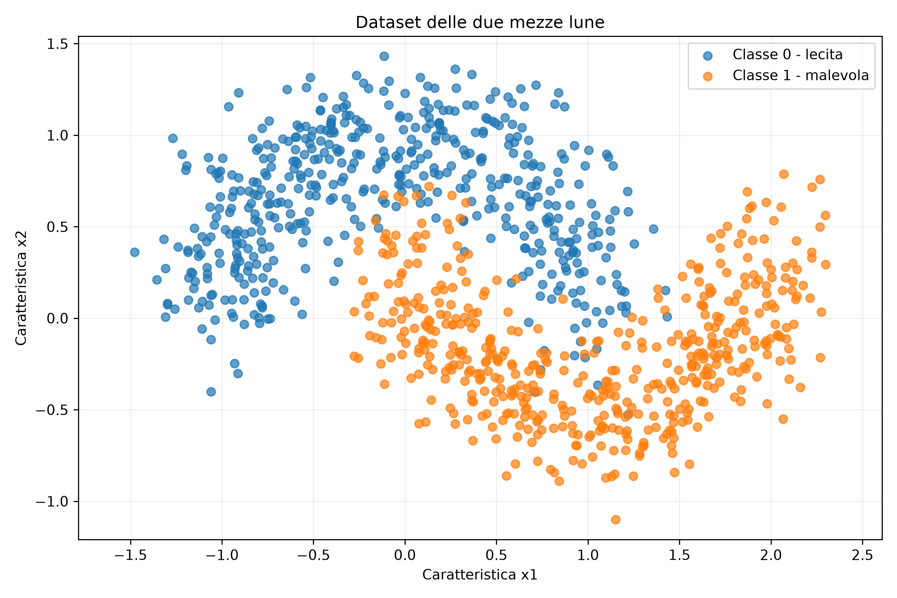
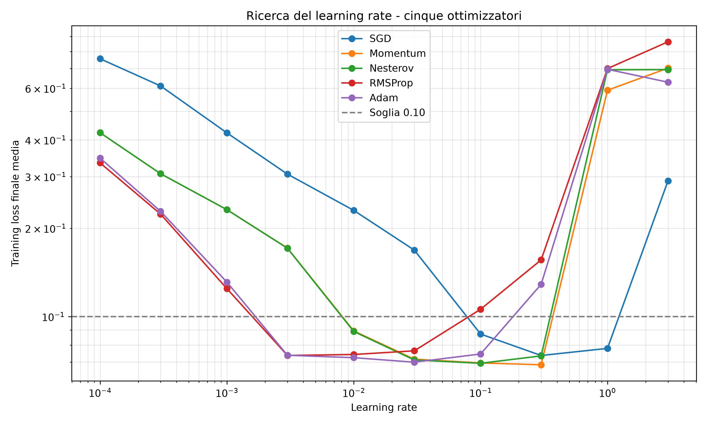
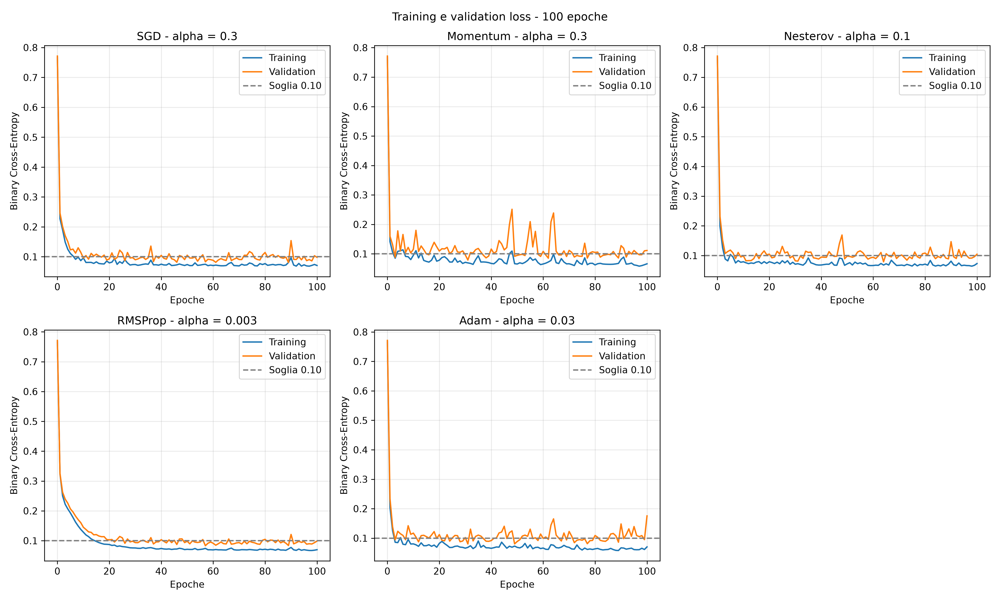

# Project 2 — Optimization for Machine Learning

## Overview

This project examines how optimization algorithms influence **neural network training** and compares different supervised learning models for binary classification. Both exercises use **synthetically generated datasets**, allowing controlled and reproducible comparisons.

## Exercise 1 — Neural Network Optimizers

**File:** [`es1_ottimizzatori.py`](es1_ottimizzatori.py)

A multilayer perceptron (MLP) with a **2–16–16–1 architecture** is trained on a noisy two-moons dataset. The exercise includes:

- Forward propagation and backpropagation implemented in NumPy.
- Numerical gradient checking.
- Implementations of **SGD, Momentum, Nesterov, RMSProp and Adam**.
- Learning-rate selection for each optimization algorithm.
- A comparison of training and validation loss over 100 epochs.

## Exercise 2 — Binary Classification Model Comparison

**File:** [`es2_confronto.py`](es2_confronto.py)

A synthetic dataset of network connections is used to distinguish legitimate from potentially malicious traffic. The exercise compares:

- **Logistic regression**, trained using gradient-based optimization.
- **Gaussian-kernel SVM**, including hyperparameter search.
- **Regularized neural network**, trained with Adam and L2 regularization.

The workflow covers temporal train/validation/test splitting, preprocessing, hyperparameter selection, model retraining and final evaluation. Reported classification metrics include **accuracy, precision, recall, F1-score** and confusion-matrix counts.

## Project files

```text
Project 2/
├── es1_ottimizzatori.py
├── es2_confronto.py
├── figure/
│   ├── dataset_lune.png
│   ├── ricerca_learning_rate.png
│   └── curve_100_epoche.png
└── README.md
```

## Requirements

- Python 3
- NumPy
- Matplotlib

```bash
pip install numpy matplotlib
```

## How to run

From the `Project 2` directory:

```bash
python es1_ottimizzatori.py
python es2_confronto.py
```

`es2_confronto.py` imports utility functions from `es1_ottimizzatori.py`, so both Python files must remain in the same directory.

## Selected visualizations

**Synthetic two-moons dataset**



**Learning-rate comparison**



**Training over 100 epochs**



## Learning objectives

The project highlights the impact of optimizer choice and hyperparameter tuning on convergence, and the importance of consistent validation procedures when comparing classification models.
