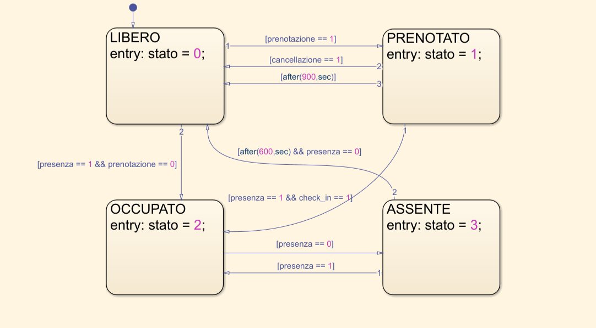
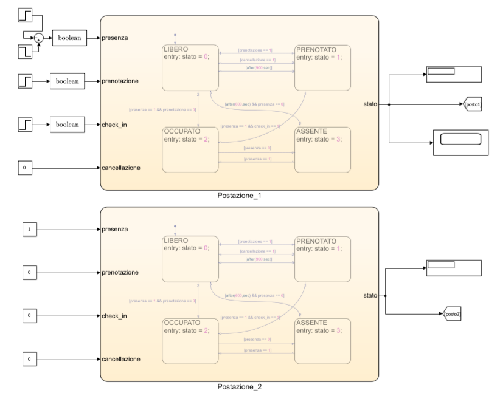
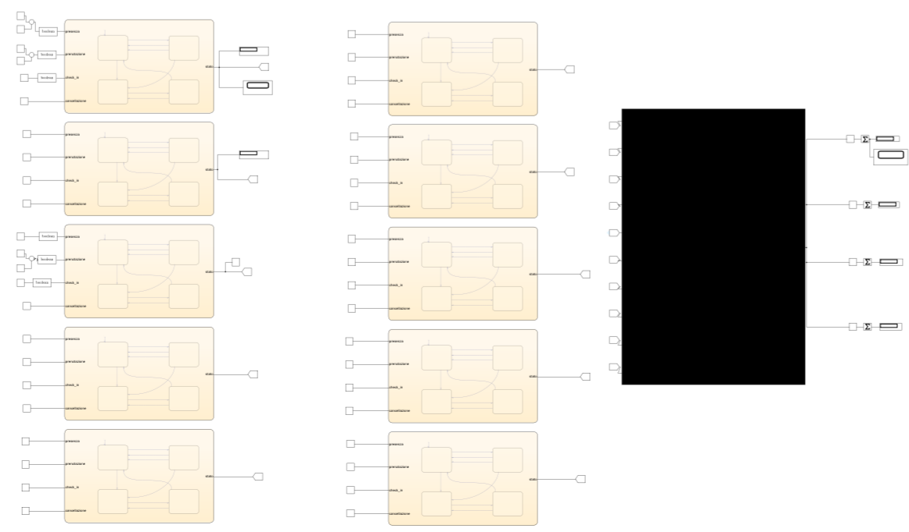
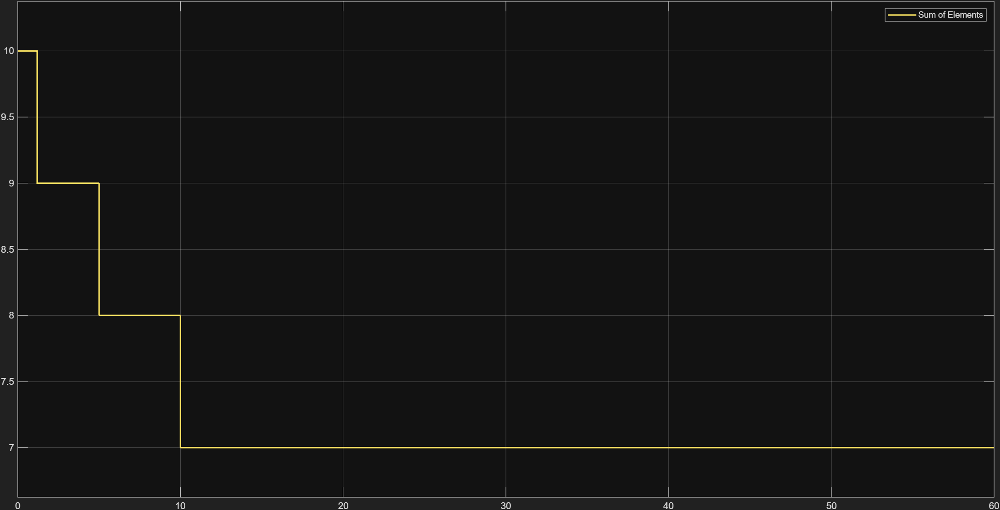
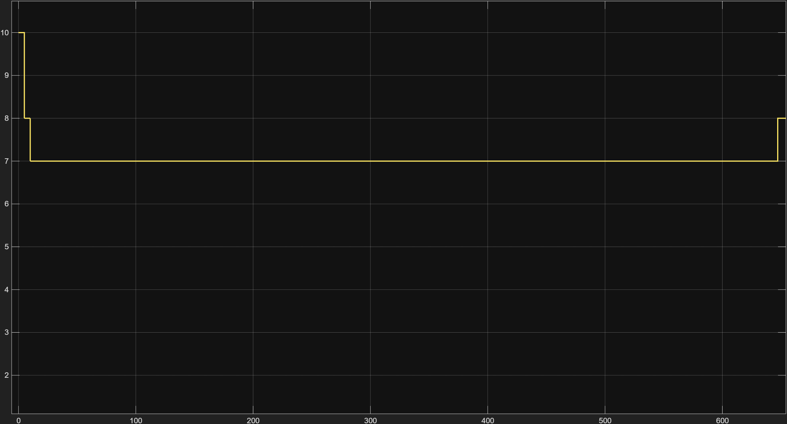
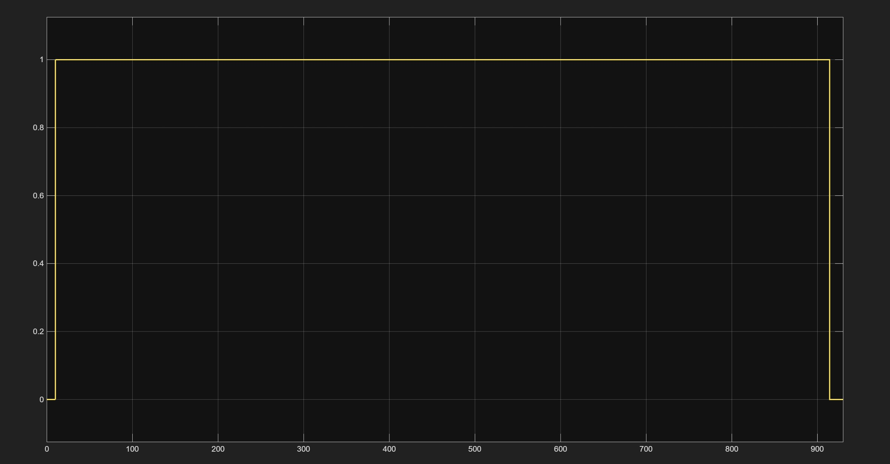
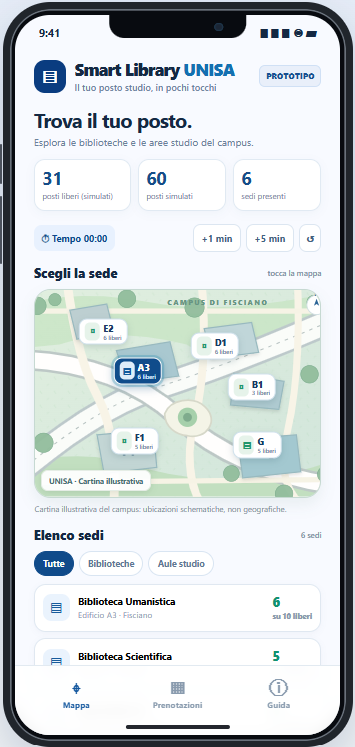

# Smart Library — Intelligent Study Space Management

Smart Library is an academic project developed for the **Smart Cities and Smart Grids** course at the **University of Salerno, Italy**.

The project uses **MATLAB, Simulink, and Stateflow** to simulate an intelligent system for managing university study spaces, complemented by an interactive web prototype developed with HTML, CSS, and JavaScript.

## Project Overview

The goal of Smart Library is to improve the availability and utilization of university study spaces through automated reservations, presence monitoring, and intelligent space management.

The system simulates **10 independent study spaces**, each managed by a Finite State Machine (FSM) with four operational states:

| State | Code | Description |
|---|---|---|
| FREE | 0 | Available for use |
| RESERVED | 1 | Reserved, awaiting check-in |
| OCCUPIED | 2 | Currently occupied |
| ABSENT | 3 | Temporarily unoccupied |

### Main Features

- Automated reservation and check-in management.
- Direct occupation without prior reservation.
- Automatic reservation expiration after **15 minutes**.
- Automatic space release after **10 minutes** of absence.
- Centralized monitoring of study space availability.
- Interactive web prototype with simulated reservations.

## Technologies

- **MATLAB / Simulink:** System modeling, simulation, and monitoring.
- **Stateflow:** Finite State Machine implementation and temporal logic.
- **HTML / CSS / JavaScript:** Interactive web prototype.

## System Architecture

### Stateflow Model



Each study space is controlled by a Finite State Machine that manages transitions between FREE, RESERVED, OCCUPIED, and ABSENT states based on input signals and temporal conditions.

### Simulink Model



The Simulink model integrates 10 independent Stateflow machines, each receiving simulated input signals representing student behavior.

### Centralized Monitoring



A centralized monitoring system tracks the number of study spaces in each state and updates overall availability during the simulation.

## Simulation Results

Three simulation scenarios were conducted to verify the system's behavior.

### 1. Initial Simulation — 60 Seconds



Reservations and direct occupation reduce the number of available study spaces from 10 to 7. Temporary absences do not immediately release occupied spaces.

### 2. Extended Simulation — 660 Seconds



After 600 seconds of continuous absence, a study space is automatically released, increasing availability from 7 to 8 spaces.

### 3. Reservation Expiration — 930 Seconds



An unconfirmed reservation automatically expires after 900 seconds, returning the study space to the FREE state.

### Quantitative Comparison

A comparison with a hypothetical traditional management approach highlights the potential benefits of automatic space release.

| Metric | Traditional | Smart Library |
|---|---|---|
| Total spaces | 10 | 10 |
| Available spaces | 7 | 8 |
| Availability | 70% | 80% |

**Result: +14.3% relative increase in available study spaces.**

This result refers to the specific simulated scenario and does not represent measured real-world performance.

## Interactive Web Prototype



An interactive web prototype demonstrates how students could interact with the Smart Library system.

### Features

- Interactive campus map and study area selection.
- Visualization of simulated seat availability.
- Study space reservation and check-in.
- Temporary absence management.
- Simulated time controls and automatic expiration.

The prototype runs directly in a web browser and operates independently of the Simulink model.

## Repository Structure

```text
Smart-Library/
├── README.md
├── prototype.html
├── simulink/
│   ├── smart_library.slx
│   └── smart_library_test900.slx
└── images/
    ├── stateflow.png
    ├── postazioni_simulink.png
    ├── monitoraggio_simulink.png
    ├── scope_posti_liberi.png
    ├── scope_esteso_dettaglio.png
    ├── scope_900.jpg
    └── prototipo.png
```

## How to Run

### MATLAB / Simulink

1. Open MATLAB with Simulink and Stateflow installed.
2. Open `simulink/smart_library.slx`.
3. Run the simulation and inspect the Display and Scope blocks.
4. Open `simulink/smart_library_test900.slx` to verify automatic reservation expiration.

### Web Prototype

Open `prototype.html` in a modern web browser. No additional installation or backend server is required.

## Limitations and Future Work

Smart Library is a simulation-based academic prototype. Presence signals are simulated, and the web interface is not directly connected to the Simulink model.

Future developments may include:

- Integration with physical presence sensors.
- Student authentication and real-time reservations.
- Synchronization between the web application and the control system.
- Predictive analysis of study space occupancy.

## Academic Context

**University of Salerno — Italy**

Master's Degree in Data Science and Innovation Management

Course: Smart Cities and Smart Grids

Academic Year: 2026/2027

---

*An academic project exploring intelligent university space management through finite state machines, simulation, and automated control.*


